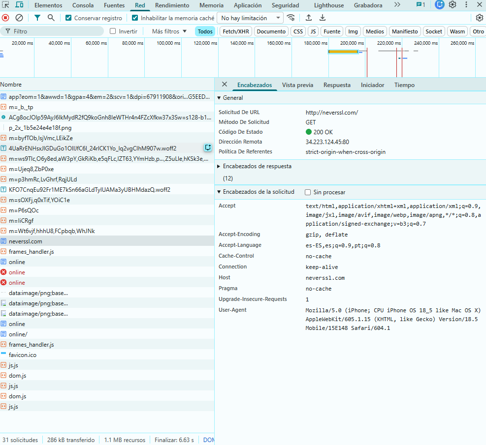
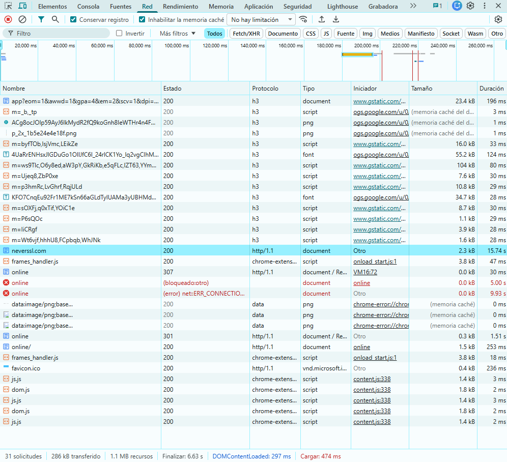

# Auditoría de Red Wi-Fi Insegura: análisis de una conexión HTTP

**Autor:** Diego Javier Pérez  
**Rol:** Auditor de seguridad junior  
**Fecha:** 2 de noviembre de 2026  
**Herramienta:** Google Chrome, herramientas de desarrollador (F12), pestaña Network

## 1. Introducción

En esta práctica analicé una solicitud web sin cifrado para identificar qué información transmite un navegador cuando utiliza HTTP. Usé las herramientas de desarrollador de Chrome y tomé capturas de la solicitud y sus encabezados. A partir de estos datos evalué qué riesgos aparecerían si la misma navegación se realizara en una red Wi-Fi pública.

La prueba se realizó desde mi propio navegador: no intercepté conexiones de terceros ni me conecté a una red pública para obtener la evidencia.

## 2. Sitio analizado

- **URL:** http://neverssl.com/
- **Host:** `neverssl.com`
- **Protocolo:** HTTP/1.1, sin cifrado TLS.
- **Puerto de destino:** 80.
- **Dirección del servidor observada:** `34.223.124.45:80`.

En HTTP, la solicitud y la respuesta no cuentan con el cifrado ni con la protección de integridad que proporciona TLS. Por eso, un tercero que logre observar el tráfico de red podría leer los encabezados, la ruta solicitada y el contenido transmitido. En HTTPS, el navegador también puede mostrar esos datos desde sus herramientas internas, pero en el trayecto por la red viajan protegidos mediante TLS. El servidor se autentica mediante su certificado, siempre que la validación sea correcta.

## 3. Evidencia observada

Abrí Network con F12, activé **Conservar registro** e **Inhabilitar la memoria caché**, ingresé a `http://neverssl.com/` y seleccioné la solicitud del documento con estado **200 OK**. La captura siguiente muestra los datos generales y los encabezados enviados.

La segunda captura permite confirmar la versión exacta del protocolo en la columna **Protocolo**.

| Dato | Valor observado |
|---|---|
| URL solicitada | `http://neverssl.com/` |
| Método | `GET` |
| Host | `neverssl.com` |
| Protocolo | `http/1.1` |
| Código de estado | `200 OK` |
| User-Agent | `Mozilla/5.0 (iPhone; CPU iPhone OS 18_5 like Mac OS X) AppleWebKit/605.1.15 ... Version/18.5 Mobile/15E148 Safari/604.1` |
| Accept-Language | `es-ES,es;q=0.9,pt;q=0.8` |

El valor **User-Agent** identifica cómo se presenta el navegador ante el servidor; no demuestra necesariamente cuál es el dispositivo físico utilizado. La dirección `34.223.124.45` corresponde al servidor de la solicitud, no a mi IP pública.

## 4. Riesgos encontrados

- **Escucha del tráfico (sniffing):** si alguien logra interceptar esta conexión HTTP desde una red compartida, puede observar el host, la ruta, el método `GET`, los encabezados y el contenido de la página. Por ejemplo, el User-Agent revela información sobre el navegador o dispositivo declarado y `Accept-Language` muestra preferencias de idioma. Estar conectado a la misma Wi-Fi no garantiza por sí solo que se pueda ver todo el tráfico ajeno: depende de la red y de la posición del atacante.
- **Ataque de intermediario (Man-in-the-Middle):** si un atacante consigue colocarse entre mi equipo y el servidor, no solo podría leer una comunicación HTTP, sino también modificar la respuesta, insertar un formulario falso o redirigir una descarga. HTTP no proporciona una verificación criptográfica que permita detectar esas modificaciones.
- **Red gemela maligna (Evil Twin):** una red Wi-Fi falsa con un nombre parecido al del local puede hacer que me conecte al punto de acceso del atacante. Desde esa posición podría intentar registrar, redirigir o modificar conexiones no protegidas.

En este ejercicio **no envié contraseñas ni cookies de autenticación**. Sin embargo, si un sitio HTTP incluyera un formulario de inicio de sesión o utilizara cookies de sesión sin protección adecuada, esos valores también podrían quedar expuestos a quien interceptara la conexión.

## 5. Cómo ayuda una VPN

- **Cifrado:** una VPN confiable cifra el tráfico entre mi dispositivo y su servidor. Esto dificulta que otros usuarios de la Wi-Fi pública lean los datos que circulan por ese tramo.
- **Túnel seguro:** los paquetes se envían mediante **encapsulamiento** dentro de un túnel cifrado hasta el servidor VPN, que luego los reenvía hacia el destino.
- **Protección del tráfico:** un observador de la red local ve principalmente la conexión con el servidor VPN, en lugar de las solicitudes HTTP individuales. Una VPN de dispositivo completo también puede proteger consultas DNS cuando están configuradas para usar el túnel y no existen fugas.
- **Privacidad:** el sitio visitado suele ver la IP de salida del servidor VPN en lugar de mi IP pública habitual. Esto reduce la exposición de mi conexión frente a la red local, pero no elimina otras formas de identificación, como iniciar sesión en una cuenta.
- **Límites:** el túnel termina en el servidor VPN. Si después se visita un sitio HTTP, el tramo entre la salida de la VPN y el sitio sigue sin cifrado HTTPS. Además, tengo que confiar en el proveedor de la VPN. Por eso **una VPN no reemplaza HTTPS**, no me hace anónimo y no evita por sí sola el phishing. Es conveniente que incluya interruptor de corte (*kill switch*) y protección contra fugas DNS.

No fue necesario instalar ni probar una VPN para esta actividad: su funcionamiento se analizó de manera teórica a partir de la comunicación HTTP observada.

## 6. Mis 3 Reglas de Oro

1. **Antes de conectarme, verifico el nombre de la red con el personal del lugar y desactivo la conexión automática a Wi-Fi desconocidas.** Cuando termino de usar una red pública, la elimino de las redes guardadas para evitar reconexiones inesperadas.
2. **Para el banco o el correo prefiero mis datos móviles y nunca ignoro una alerta de certificado.** Si utilizo Wi-Fi pública, compruebo que el dominio sea el correcto y que la página use HTTPS antes de ingresar información sensible.
3. **Si necesito trabajar desde una Wi-Fi pública, utilizo una VPN confiable con interruptor de corte y control de fugas DNS.** Aun con la VPN activa, evito enviar contraseñas o datos bancarios a través de páginas HTTP.
